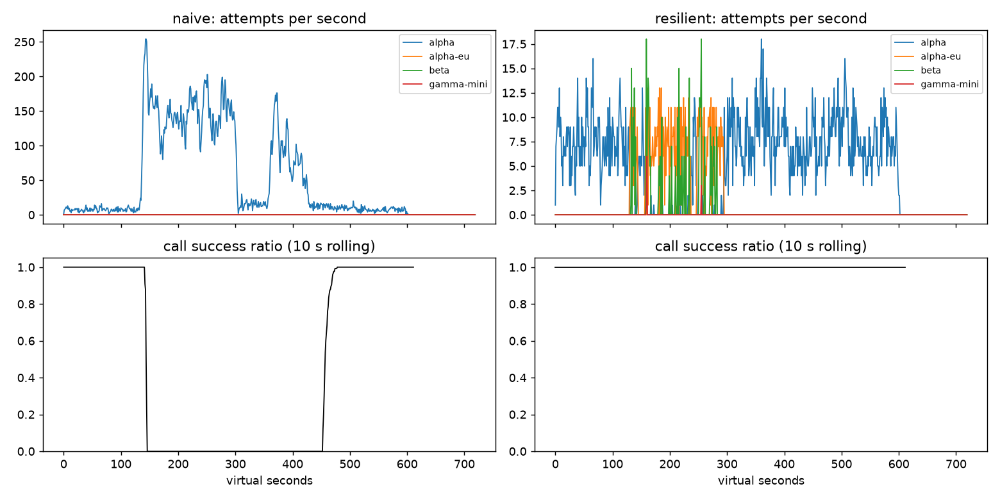

# Lab 25B — Report

**Họ tên / nhóm:** Bùi Quốc Việt — MSV 2A202602884  **Commit:** `<điền commit hash>`  **Điểm tự động (`make grade`):** 84 / 88
(4 điểm còn lại là phần "dữ liệu SLO ẩn" chỉ chạy trên máy giảng viên; xem mục 5 về kiểm thử độ bền.)

> Mọi số liệu dưới đây lấy từ `reports/gameday/*.json`, `reports/cache/*.json`, `reports/workflows.json`,
> `reports/slo.json` (seed 25), trừ khi ghi rõ là thí nghiệm.

## 1. Kết quả Game Day (naive vs của bạn)

| Băng | Client | availability | p95 (s) | amplification | retry_ratio | cost/turn | recovery (s) | PASS? |
|---|---|---:|---:|---:|---:|---:|---:|:---:|
| G1 | naive | 0,7194 | 7,16 | 7,74 | 6,74 | 2,16 | 4 | ✗ |
| G1 | yours | **1,0000** | 4,73 | 1,06 | 0,002 | 2,10 | 0 | ✓ |
| G2 | naive | 0,4560 | 15,03 | 9,90 | 8,90 | 4,63 | 155 | ✗ |
| G2 | yours | **1,0000** | 10,75 | 1,04 | 0,005 | 2,12 | 0 | ✓ |
| G3 | naive | 1,0000 | 4,77 | 1,16 | 0,164 | 2,33 | 0 | ✗ |
| G3 | yours | **1,0000** | 4,72 | 1,07 | 0,035 | 2,15 | 0 | ✓ |
| G4 | naive | 1,0000 | 13,76 | 1,00 | 0,004 | 2,01 | 0 | ✗ |
| G4 | yours | **1,0000** | 5,68 | 1,01 | 0,002 | 2,07 | 0 | ✓ |
| G5 | naive | 0,3699 | 5,36 | 17,03 | 16,03 | 2,12 | – | ✗ |
| G5 | yours | **0,8179** | 5,48 | 1,00 | 0,002 | 2,50 | – | ✓ |
| G6 | naive | 0,5170 | 4,84 | 12,34 | 11,34 | 2,01 | 0 | ✗ |
| G6 | yours | **1,0000** | 6,09 | 1,06 | 0,028 | 2,18 | 0 | ✓ |

Các check đặc thù (client của tôi): G1 `retry_after_violations = 0` (naive: 36.027); G2 `primary_share_after_restore = 1,0`;
G5 `client_error_retries = 0` (naive: 9.149), `unneeded_failovers = 0`, 413 lượt GiveUp đều là `client_error`
(request malformed — không client nào cứu được); G6 `incompatible_routes = 0`.

**Độ bền (băng ẩn + nhiều seed):** tôi chạy 6 băng public × 20 seed (1–20) → 120/120 PASS. Tôi cũng tự viết 9 băng
"lệch" (dời thời điểm, đổi cường độ: G1 traffic ×3 + alpha 10 rps; G2 capacity 0,15 và 0,4; G3 error 15% và 45%;
G4 +4 s và +7 s; G5 dời quota sớm hơn; G6 outage 360 s + beta 8 rps) × 20 seed → tất cả PASS. Ngoại lệ duy nhất là
một biến thể G5 tôi cố ý làm khắc nghiệt hơn đề (75% malformed trong 160 s). Ở đó availability chỉ 0,71, nhưng
amplification vẫn 1,003 và `unneeded_failovers = 0`. Phần lỗi ấy là request sai, đúng tinh thần FAQ: "không làm tệ thêm".

## 2. Cấu hình client và lý do

| Tham số | Giá trị | Vì sao (dựa trên băng nào, số liệu nào) |
|---|---:|---|
| attempt_timeout_s | 8,0 | Lúc bình thường một call mất ~1,2–1,8 s (p95 lượt = 4,7 s cho **2** call), nên 8 s không cắt nhầm call khỏe. Với deadline 30 s/lượt (2 call), 8 s vẫn để đủ thời gian fail over 2–3 lần. G6 (alpha-eu treo): timeout 8 → availability 1,0; timeout 30 → 0,9488 với 104 GiveUp `deadline` (thí nghiệm 2). Quét 4/6/8/12 s: cả 3 băng G2/G4/G6 đều PASS, nên chọn 8 s ở giữa cho an toàn hai phía. |
| max_attempts_per_provider | 2 | 1 retry cùng provider là đủ cho lỗi lẻ tẻ (G3: retry_ratio 0,035 ≤ 0,10). Lỗi kéo dài thì breaker + failover xử lý. Thử 5 attempt khi không có budget/breaker: G3 retry_ratio 0,162 (FAIL), G2 amplification 1,678 (FAIL). |
| backoff_base_s / cap_s | 0,25 / 4,0 | Full jitter, retry thứ 1 rơi trong [0; 0,25 s], retry thứ 2 trong [0; 0,5 s]: nhỏ so với deadline 30 s nhưng đủ để phân tán. Cap 4 s < timeout 8 s, nên một lần chờ không bao giờ ăn quá nửa thời gian của một attempt. |
| retry_budget_ratio | 0,1 (min 0,5/s, max 20) | Retry ≤ ~10% lượng request gốc. Đây là lớp chặn cuối khi breaker không trip được: thí nghiệm 1, breaker tắt + 5 attempt → có budget: G2 amplification 1,38, retry 0,058; không budget: 1,68 / 0,499. |
| breaker.window_size / min_calls | 20 / 10 | Với ~8 call/s, 20 kết quả ≈ 2,5 s lưu lượng của alpha: phản ứng nhanh ở G2 (alpha không còn được gửi nhiều ngay từ khung 120–150 s: 3,2 attempt/s so với 90,8 của naive). min_calls 10 tránh trip vì 2–3 lỗi lẻ lúc ít traffic. |
| breaker.failure_rate_threshold | 0,5 | G3 có 30% lỗi 500: dưới ngưỡng nên breaker thường KHÔNG trip, retry 1 lần sang chính alpha là đủ (availability 1,0, retry_ratio 0,035), và tránh dồn toàn bộ traffic sang beta đắt hơn (cost 1,4). G2/G6 có tỷ lệ lỗi ~100% nên trip ngay. |
| breaker.slow_call_s | 5,0 | G4: alpha chậm thêm 5 s, tức ~6,2 s/call ≥ 5 s → coi là "chậm" → trip theo `slow_call_rate` → chuyển sang alpha-eu. p95 = 5,68 s (naive 13,76 s, ngưỡng 10 s). Đặt 5 s cao hơn hẳn ~1,8 s của call chậm nhất lúc bình thường (beta), nên không trip nhầm. |
| breaker.open_duration_s | 10,0 | Sau 10 s thì thử probe lại: G2/G4/G6 quay lại alpha ≥ 90% ngay sau sự cố (`primary_share_after_restore` 1,0 / 1,0 / 1,0; G1 0,906), recovery 0 s ≤ 30 s. Lâu hơn (30–60 s) sẽ trễ quay về primary rẻ hơn. |
| breaker.half_open_max_probes | 2 (cần 2 success) | Chỉ 2 request thử trên provider vừa hồi phục, không dồn cả hàng đợi vào (thundering herd). 2/2 thành công mới CLOSED, tránh đóng breaker vì 1 call may mắn. |
| quota_cooldown_s | 300 | Hết quota là chuyện billing, không tự hết sau vài giây. G5: sau khi account A hết quota thì cả lượt đi beta ngay, không gõ lại alpha mỗi request. |

Sơ đồ quyết định của `on_error`:

```
classify(err)
 ├─ CLIENT_ERROR (400/401/422)  → breaker.release     → GiveUp("client_error")   (không retry, không failover)
 ├─ QUOTA_EXHAUSTED (429 quota) → breaker.release     → cooldown 300 s           → failover ngay
 ├─ RATE_LIMITED (429 + RA)     → breaker.release     → cooldown đến now+retry_after (chia sẻ mọi call) → failover ngay
 └─ OVERLOADED / SERVER_ERROR / TIMEOUT
          → breaker.on_failure
          → tries < max_attempts AND breaker != OPEN AND kịp deadline AND budget.try_acquire_retry()?
                 ├─ có   → Send(cùng provider, delay = full-jitter backoff)
                 └─ không → failover sang bậc kế tiếp của ladder
_route: bỏ qua provider đang cooldown hoặc breaker từ chối; hết ladder → chờ cooldown rate-limit
        ngắn nhất (≤ 5 s, breaker không OPEN, kịp deadline, không bao giờ trước retry_after) → nếu không: GiveUp.
ladder("tool") = [alpha, alpha-eu, beta]   (lọc supports_tools — không bao giờ gamma-mini)
ladder("chat") = [alpha, alpha-eu, beta, gamma-mini]
```

## 3. Ba thí nghiệm

**1. Retry budget là lớp phòng thủ cuối** (breaker vô hiệu `min_calls: 1e9`, `max_attempts_per_provider: 5`):

| Băng | Cấu hình | availability | amplification | retry_ratio | recovery (s) | PASS |
|---|---|---:|---:|---:|---:|:---:|
| G2 | breaker tắt, **có** budget | 0,9987 | 1,382 | 0,058 | 0 | ✓ |
| G2 | breaker tắt, **không** budget | 0,9657 | 1,678 | 0,499 | 25 | ✗ |
| G2 | breaker bật, không budget | 1,0000 | 1,054 | 0,007 | 0 | ✓ |
| G3 | breaker tắt, **có** budget | 1,0000 | 1,135 | 0,067 | 0 | ✓ |
| G3 | breaker tắt, **không** budget | 1,0000 | 1,163 | 0,162 | 0 | ✗ |
| G3 | breaker bật, không budget | 1,0000 | 1,043 | 0,027 | 0 | ✓ |

Khi breaker hỏng, chỉ còn budget giữ retry ≤ ~10%: bỏ budget thì G2 retry_ratio tăng 8,6 lần (0,058 → 0,499) và
recovery thành 25 s (sát ngưỡng 30 s), với 81 lượt hết deadline. Khi breaker *hoạt động đúng*, budget gần như không
cần trên các băng này (amplification 1,05), vì breaker đã chặn cả provider. Nhưng hai cơ chế đo hai thứ khác nhau:
breaker theo **từng provider** và chỉ trip khi tỷ lệ lỗi ≥ 50%; budget giới hạn **tổng lượng retry** bất kể nguyên
nhân. Lỗi 30% (G3) nằm dưới ngưỡng breaker, cấu hình breaker sai, hay lỗi rải đều trên nhiều provider đều lọt qua
breaker. Budget là chốt chặn cuối để một sự cố không biến thành retry storm. Vì thế nên giữ cả hai.

**2. `attempt_timeout_s: 30`:**

| Băng | timeout | availability | give_up_reasons | p95 (s) |
|---|---:|---:|---|---:|
| G6 | 8 | **1,0000** | {} | 5,93 |
| G6 | 30 | **0,9488** ✗ | deadline: 104, no_provider_available: 18 | 5,44 |
| G4 | 8 | 1,0000 | {} | 5,63 |
| G4 | 30 | 1,0000 | {} | 5,68 |

Ở G6, alpha-eu *treo* (không trả lỗi). Với timeout 30 s, mọi call rơi vào alpha-eu chờ đến hết deadline 30 s của user
rồi mới biết là hỏng, không còn thời gian fail over sang beta: 104 lượt `deadline`, availability rớt 5 điểm %.
p95 lại *giảm* (5,93 → 5,44) vì nó chỉ tính lượt thành công; các lượt treo đã bị loại (survivorship bias). G4 gần như
không đổi vì ở đó alpha *chậm* (~6,2 s) chứ không treo: dưới cả 8 lẫn 30 s, nên timeout không bao giờ kích hoạt. G4
được xử lý bởi **slow-call breaker**, không phải timeout. Timeout "đúng" nên suy ra từ **deadline của user và số lần
fail over cần có**: 30 s cho 2 call, mỗi call cần chỗ cho ~2 lần thử → ≤ 8 s/attempt. Giá trị đó phải ở trên p99 lúc
bình thường (~3–4 s) để không cắt nhầm call khỏe. Quét 4/6/8/12 s đều PASS cả G2/G4/G6.

**3. Bỏ lọc tool calling khỏi `ladder()`** (G6): `incompatible_routes = 244`, `give_up_reasons = {incompatible_model_output: 244}`,
availability 1,0 → **0,8977** (FAIL). Nói theo ngôn ngữ product: *"Trong 5 phút provider A sập, cứ 10 khách thì
khoảng 1 khách (244 người) yêu cầu hoàn tiền bị 'trả lời' bởi một model không biết gọi công cụ. Agent không tra được
đơn và không hoàn được tiền. Khách nhận một câu trả lời vô nghĩa, trong khi beta vẫn còn sức để xử lý đúng."*
Fallback sang model rẻ hơn chỉ hợp lệ khi model đó *làm được* việc; nhanh mà sai còn tệ hơn chậm.

## 4. Workflow hoàn tiền

| Executor | completion | crashes | duplicate refunds | duplicate emails | lost refunds | overpaid | wasted LLM / crash |
|---|---:|---:|---:|---:|---:|---:|---:|
| naive | 1,00 | 81 | 128 | 81 | 0 | 1.496.700 ¢ (~14.967 $) | 1,123 |
| yours | 1,00 | 66 | **0** | **0** | **0** | **0** | **0,303** |

(500 workflow; executor của tôi: 500 lần payment thực thi cho 500 session; 2.500 checkpoint = 5 step × 500.)

- **Chỉ idempotency key là chưa đủ:** key chặn được hoàn tiền trùng, nhưng worker mới vẫn chạy lại từ đầu, gọi lại
  LLM `classify`/`summarize` (tốn tiền, `wasted_llm_per_crash` sẽ > 0,6). Nó cũng chỉ an toàn nếu step *có* hỗ trợ
  idempotency key; các step không có key (LLM, đọc order) bị làm lại.
- **Chỉ checkpoint là chưa đủ:** crash *giữa* lúc payment đã chạy và lúc ghi checkpoint (`WorkerCrash` sau commit,
  hoặc `ServiceTimeout` khi response bị mất). Checkpoint chưa có, nên worker mới gọi payment lại. Không có key ổn
  định thì đó là hoàn tiền lần 2. Key `refund-wf:{session}:{step}` khiến lần gọi lại trả về đúng kết quả cũ.
- **Ghi checkpoint *trước* khi gọi payment:** nếu worker chết sau khi ghi checkpoint mà trước/trong khi gọi payment,
  worker mới thấy checkpoint "đã xong" và bỏ qua step. Tiền không bao giờ được hoàn (**lost refund**), mà hệ thống
  vẫn tin là đã hoàn. Thứ tự đúng: chạy step (có key) → thành công → ghi checkpoint.

## 5. Alerting & error budget

| Sự cố | Mong đợi | Naive alerter (5 phút đơn lẻ) | Burn-rate alerter | Độ trễ phát hiện (burn-rate) |
|---|---|---|---|---:|
| checkout_bug | page | page (1 phút) | page ✓ | 27 phút (hạn 35) |
| provider_outage | page | page (0 phút) | page ✓ | 4 phút (hạn 8) |
| deploy_blip | none | **page (false)** | không ✓ | – |
| slow_leak | ticket | **không phát hiện** | ticket ✓ (không page) | 1.337 phút ≈ 22,3 h (hạn 30 h) |
| degraded_evening | page | page (214 phút) | page ✓ | 291 phút (hạn 330) |
| night_spike | none | **page (false)** | không ✓ | – |
| small_bump | none | **page (false)** | không ✓ | – |

Naive: 7 page, 3 false page, bỏ sót slow_leak → FAIL. Burn-rate: 3 page + 1 ticket, 0 false page → PASS.
Kiểm thử thêm trên dữ liệu tự sinh lại với 5 seed khác (dời sự cố ±3 ngày): đạt mọi tiêu chí. Lần "trượt" duy nhất
xảy ra khi phép dời ngẫu nhiên làm `degraded_evening` chồng lên `slow_leak`; page đó thuộc về degraded_evening.

**Error budget 30 ngày:** 25.901.755 request, được phép 129.508,8 lỗi (0,5%). Thực tế 55.618 lỗi (availability
99,7853%) → **đã tiêu 42,95%, còn 57,05%** → **không** đóng băng release (chỉ đóng băng khi budget còn ≤ 0).

**Vì sao `small_bump` không nên đánh thức ai?** 20 phút ở 12% lỗi chỉ tiêu ~1% budget tháng. Burn rate trong 20 phút
đó là 24×, nhưng cửa sổ 1 giờ chỉ thấy 24 × 20/60 ≈ 8× < 14,4×, và cửa sổ 6 giờ thấy ~1,3× < 6×. Với tốc độ này
budget không gặp nguy; page lúc đó chỉ gây alert fatigue. Sự cố tự hết, nên xử lý bằng ticket/review trong giờ làm việc.

## 6. Postmortem — Băng G2 với client naive (blameless)



*Nguồn: `reports/gameday/naive_G2_overload_storm_timeseries.csv` (gộp theo cửa sổ 30 s) và `reports/gameday/naive.json`.*

**Tóm tắt:** Lúc t=120 s, deployment `alpha` mất 75% GPU trong 3 phút. Client v1 có 3 tầng retry chồng nhau, delay cố
định, không breaker/fallback. Nó khuếch đại tải lên gần 20 lần, biến sự cố 3 phút của provider thành 5 phút sập hoàn
toàn (t≈150–450 s) và kéo dài thêm 155 s sau khi provider đã hồi phục. Mọi traffic vẫn dồn vào alpha suốt sự cố,
trong khi alpha-eu và beta còn trống.

**Ảnh hưởng:** 1.285 / 2.362 lượt user thất bại (availability 45,6%). Trong ~300 s (t≈150–450) gần như 0% call thành
công. 34.475 attempt cho 3.481 call (amplification 9,9×), cost/lượt thành công 4,63 (gấp 2,2 lần bình thường).
Error budget: lưu lượng ~4 lượt/s × 30 ngày ≈ 10,37 triệu lượt → budget 0,5% ≈ 51.840 lượt lỗi. Riêng sự cố này đốt
**~2,5% budget tháng trong 10 phút**; burn rate trong khung sự cố ≈ 0,544 / 0,005 ≈ **109×** (gấp 7,5 lần ngưỡng
page 14,4×).

**Timeline** (giây ảo):

| t | Sự kiện | Bằng chứng (số từ CSV, cửa sổ 30 s) |
|---:|---|---|
| 0–120 | Bình thường | 7,3–7,9 attempt/s lên alpha, success 100% (212/212 … 234/234) |
| 120 | alpha mất 75% năng lực (trigger) | khung 120–150: attempt/s vọt lên **90,8** (×12), success **52%** (51/98) |
| ~140 | Retry 3 tầng bùng nổ; vượt cả rate limit 20 rps của chính tenant | đỉnh ~250 attempt/s; success ratio 10 s rơi về 0 lúc ~145 s |
| 150–300 | Sập hoàn toàn, retry storm tự duy trì | **140–156 attempt/s** (~19× bình thường), **0** call thành công (0/631) |
| 300 | alpha hồi phục hoàn toàn | — |
| 300–360 | Hệ thống **vẫn** không hồi phục | attempt/s giảm còn 23,4 và 15,8 nhưng success vẫn **0** (0/55, 0/114) |
| 360–420 | Đợt retry thứ hai (delay cố định → các client đồng bộ quay lại cùng lúc) | attempt/s tăng lại **113,2** rồi 77,8, success 0 (0/125, 0/127) |
| 420–450 | Tải giảm dần khi các call cũ hết lượt retry / hết deadline | 21,5 attempt/s, success vẫn 0 (0/108) |
| ~455 | Bắt đầu hồi phục | khung 450–480: success **90%** (299/332) |
| 480+ | Bình thường trở lại | 10,4 → 7,3 attempt/s, success 100%; `recovery_s = 155` |

**Trigger vs root cause:**
- *Trigger* là alpha mất 75% GPU (từ 18 slot còn ~4,5 slot, tức năng lực ~4 rps so với ~8 call/s cần xử lý). Một
  sự cố như vậy xảy ra định kỳ và nằm ngoài tầm kiểm soát của ta.
- *Root cause* là cách client phản ứng: **3 tầng retry chồng nhau** (app × gateway × SDK, tối đa 36 attempt/call),
  **delay cố định, không jitter**, **không retry budget**, **không circuit breaker**, **không fallback**, và **bỏ qua
  `retry-after`** (28.381 vi phạm). Mỗi lỗi sinh ra nhiều request mới; tải đổ vào alpha tăng từ ~8 lên ~150 attempt/s
  đúng lúc alpha yếu nhất.
- *Vì sao không tự hồi phục sau t=300 (metastable failure):* (1) Hàng đợi 10 s của alpha đầy request mà client **đã bỏ
  rồi** (2.737 `client_timeout`): server vẫn xử lý chúng, nên năng lực được trả lại bị tiêu vào việc vô ích. (2) Mỗi
  request hết hạn lại sinh thêm retry, nên tải đưa vào (> 100 attempt/s ở 360–420) vẫn cao hơn năng lực thật (18 slot /
  1,2 s ≈ 15 rps) và cao hơn rate limit 20 rps (26.298 lỗi `rate_limit_exceeded`). Các lỗi 429 này lại bị retry mà
  không chờ `retry-after`. (3) Delay cố định làm các retry đồng bộ thành từng đợt (đợt 2 ở 360–420). Vòng lặp
  "quá tải → timeout/429 → retry → quá tải hơn" tự duy trì cho đến khi các call cạn lượt retry và user rời đi; tải tự
  rút xuống chứ không phải provider "khỏi bệnh".

**Điều gì giúp / điều gì làm tệ hơn:**
- *Giúp:* rate limit 20 rps phía provider giới hạn một phần tải thật vào hàng đợi; deadline 30 s của user rốt cuộc
  cắt đứt vòng lặp (585 GiveUp `deadline`).
- *Tệ hơn:* retry nhân 3 tầng; delay cố định (đồng bộ hóa đợt retry); bỏ qua `retry-after`; không fallback (alpha-eu và
  beta rảnh suốt sự cố, 0 attempt); timeout phía client không hủy công việc phía server.
- *Đối chứng:* cùng băng, client mới giữ availability 100%, amplification 1,04, recovery 0 s. Breaker đẩy traffic sang
  alpha-eu/beta ngay từ khung 120–150 (alpha chỉ 3,2 attempt/s), và quay lại alpha 100% sau t=300.

**Action items:**

| # | Hành động | Loại | Owner | Cách kiểm chứng |
|---|---|---|---|---|
| 1 | Bỏ retry ở gateway và SDK, chỉ giữ **một tầng** retry trong `ResilientClient` (full jitter, tôn trọng `retry-after`, retry budget 10%) | prevent | Team Platform/LLM Gateway | CI chạy `make gameday`: G2 amplification ≤ 1,2 (hiện 1,04), G1 `retry_after_violations = 0` |
| 2 | Circuit breaker sliding-window (tỷ lệ lỗi + slow-call) theo từng deployment + fallback ladder alpha → alpha-eu → beta có lọc tool calling | mitigate | Team Agent Runtime | G2 availability ≥ 95% và recovery ≤ 30 s, G6 `incompatible_routes = 0` trên 3 seed trong CI |
| 3 | Alert burn-rate đa cửa sổ (14,4× 1h&5m, 6× 6h&30m) trên availability lượt user, và alert riêng trên **amplification > 2** và tỷ lệ 429/529 theo provider | detect | Team SRE | Replay CSV G2 vào alerter: page trong ≤ 5 phút kể từ t=120; `make slo` 0 false page |
| 4 | Game Day định kỳ: chạy 6 băng sự cố trên mỗi PR đụng client LLM; chặn merge nếu băng nào FAIL | prevent | Tech Lead ShopAgent | Job `grade.yml` bắt buộc pass trước khi merge |
| 5 | Load-shedding: khi breaker OPEN trên mọi provider, trả câu trả lời degraded ngay thay vì xếp hàng | mitigate | Team Agent Runtime | G6 biến thể "mọi provider sập": p95 thời gian trả lời degraded ≤ 2 s |

*Blameless:* sự cố không do một người hay một commit. Mỗi tầng retry đều "hợp lý" khi đứng riêng, và chúng được thêm
bởi các team khác nhau, vào các thời điểm khác nhau. Lỗ hổng là ở quy trình: chưa ai nhìn toàn bộ đường đi của một
call, và chưa có Game Day để đo amplification trước khi lên production.

## 7. Một điểm yếu còn lại

**G2 p95 = 10,75 s** (cao nhất trong 6 băng, dù băng G2 không chấm p95). Breaker cần ≥ 10 kết quả mới trip. Trong vài
giây đầu sự cố, các call đã nằm trong hàng đợi dài của alpha (tối đa 10 s trước khi 529) phải chờ hết rồi mới fail
over; nửa-mở mỗi 10 s cũng để vài probe nhận lại độ trễ cao. Một rủi ro khác là **chi phí** khi beta gánh tải: G5
cost/turn 2,50 (so với 2,07–2,18 ở các băng khác) vì khi account A hết quota mọi lượt đi beta (giá 1,4).
*Cách sửa:* (1) **hedging** cho call đang chờ quá ~p95 bình thường (≈2 s): gửi thêm 1 bản sang provider kế tiếp, lấy
kết quả đầu tiên, giới hạn bằng chính retry budget; (2) breaker dựa trên **thời gian chờ hàng đợi / tỷ lệ 529 gần
đây** để trip trước khi đủ 10 kết quả; (3) với call `chat` khi chỉ còn beta, ưu tiên `gamma-mini` (0,2) nếu chất
lượng chấp nhận được, kèm alert khi cost/turn > 2,3 kéo dài > 10 phút.

## 8. Cache (Part G)

Số từ `reports/cache/*.json` (`make cache`, seed 25):

| Client | availability | faq_availability | cache_hit_ratio | stale_served | wrong_answers | outdated_answers | cost/turn | PASS? |
|---|---:|---:|---:|---:|---:|---:|---:|:---:|
| resilient (không cache) | 0,8373 | 0,8424 | 0,000 | 0 | 0 | 0 | 1,386 | ✗ |
| cached — cấu hình starter (0,80 / 600 / 0) | 0,8469 | 0,8587 | 0,742 | 0 | **181** (other_question) | **80** | 0,921 | ✗ |
| cached (của tôi: 0,92 / 24 / 300) | **0,9120** | **0,9645** | **0,564** | 189 | **0** | **2** | **0,974** | ✓ |

| Tham số `cache:` | Giá trị | Vì sao (số liệu nào) |
|---|---:|---|
| similarity_threshold | 0,92 | Trong embedding mô phỏng, các paraphrase cùng ý định có cosine ~0,95–0,98, còn các cặp "gần mà khác" (chính sách hoàn tiền vs thời gian hoàn tiền, ship nội thành vs ngoại tỉnh…) có centroid cách nhau 0,86 (câu cụ thể ≈ 0,83–0,88). Ở 0,80: 134 câu trả nhầm `other_question`. Ở 0,92: 0 câu sai, hit ratio 0,564. Ở 0,97: hit chỉ 0,462 < 0,5 (FAIL), vì bắt đầu bỏ lỡ paraphrase hợp lệ. |
| ttl_s | 24 | TTL là thứ **duy nhất** giới hạn `outdated_answers` (bảng phí ship đổi lúc t=480 không có webhook). TTL 300 → 95 câu lỗi thời (FAIL); TTL 600 (starter) → 80. Quét 20–60 s trên 30 seed × 6 biến thể băng (dời thời điểm update/outage/deploy): TTL 60 có lúc lên 29 outdated (seed 25 chỉ 3 là do may: deploy prompt v2 lúc 420 làm mới cache đúng 60 s trước 480). TTL 24 → tệ nhất 13 outdated (≤ 15) và hit ratio tệ nhất 0,526 (≥ 0,5). |
| max_stale_s | 300 | Sự cố "mọi provider sập" dài 120 s (240–360). Stale window phải ≥ thời lượng sự cố thì entry cuối cùng trước sự cố vẫn dùng được ở cuối sự cố. `max_stale_s: 0` → faq_availability 0,8547 (FAIL); 60 → 0,9163 (FAIL); 300 → 0,9645. 300 s còn đủ cho một sự cố dài gấp 2,5 lần. Stale chỉ được phục vụ khi provider bỏ cuộc, nên không làm tăng outdated lúc bình thường. |
| max_entries | 500 | Catalog FAQ chỉ vài chục ý định × vài paraphrase. 500 entry không bao giờ bị LRU đẩy ra trong băng, nhưng vẫn giới hạn bộ nhớ. |

**Thí nghiệm:**

1. **Ngưỡng** (TTL 24, stale 300):

   | threshold | hit ratio | wrong_answers | cost/turn | PASS |
   |---:|---:|---:|---:|:---:|
   | 0,80 | 0,568 | 134 (`other_question`) | 1,026 | ✗ |
   | 0,92 | 0,564 | 0 | 0,974 | ✓ |
   | 0,97 | 0,462 | 0 | 1,044 | ✗ |

   Ở 0,80, các câu bị trả nhầm là những cặp ý định gần nhau trong catalog: "chính sách hoàn tiền" ↔ "tiền hoàn về
   trong bao lâu", "đổi size" ↔ "đổi màu", "phí ship nội thành" ↔ "phí ship ngoại tỉnh", "phương thức thanh toán" ↔
   "có ship COD không". Hit ratio cao hơn chút nhưng là hit *sai*. Ở 0,97, cache quá khắt khe nên tốn thêm call
   provider (cost 1,044 so với 0,974).
2. **TTL**: 30 s → hit 0,592, outdated 2; 60 s → hit 0,652, outdated 3; 300 s → hit 0,731, outdated **95** (FAIL).
   Webhook không giúp được `outdated_answers` vì thay đổi bảng phí ship là *im lặng*: không có sự kiện nào để
   invalidate. Cache không thể biết câu trả lời đã sai, nên tuổi tối đa của entry (TTL) là giới hạn trên duy nhất cho
   việc phục vụ một câu trả lời đã lỗi thời. (Thay đổi chính sách hoàn tiền lúc 150 *có* webhook → `invalidate` →
   0 câu `ignored_invalidation`.)
3. **Stale-if-error** `max_stale_s: 0`: faq_availability 0,9645 → **0,8547**, availability tổng 0,912 → 0,8447,
   stale_served 189 → 0. Trong 120 s mọi provider sập, không còn bậc "cached response" của fallback ladder, nên mọi câu
   FAQ đều thất bại.

**Trả lời:**

- *Vì sao câu hỏi cá nhân không được cache, kể cả theo từng user?* (1) **Rò rỉ dữ liệu:** "Đơn #48213 của tôi đâu?"
  và "Đơn #48214 của tôi đâu?" có cosine ~0,99, nên semantic cache sẽ trả đơn của người A cho người B. Đây là sự cố
  bảo mật/quyền riêng tư, không chỉ là trả lời sai. (2) **Dữ liệu sống:** trạng thái đơn, tiền hoàn, điểm thay đổi theo
  từng phút, và không có webhook nào báo khi đơn đổi trạng thái. Cache theo user vẫn trả trạng thái cũ ("đang giao" khi
  đã giao). (3) **Gần như không có lợi:** mỗi user hỏi đơn của mình rất ít lần, nên hit ratio thấp mà rủi ro cao. Vì
  vậy dùng allowlist: chỉ FAQ chung (`personal = False`) mới được cache.
- *Dashboard vẫn xanh nhờ cache: alert dựa trên số nào?* Không alert trên availability phía user (đang bị cache che).
  Alert trên **sức khỏe phía provider**: tỷ lệ lỗi/thành công của *attempt* theo từng provider, số `GiveUp` của inner
  client (`no_provider_available`), trạng thái breaker (OPEN trên mọi provider), và đặc biệt **tỷ lệ `stale_served` /
  tổng FAQ**. Bình thường số này ≈ 0; trong sự cố C1 là 189 câu trong 2 phút. Rule ví dụ: page khi
  `stale_served_ratio > 5%` trong 5 phút, hoặc khi tỷ lệ attempt thành công trên mọi provider < 50% trong 2 phút.
  Kèm theo đó, các lượt không phải FAQ (cần tool call) vẫn thất bại, nên availability *của lượt tool* là tín hiệu thật
  không bị cache che.
